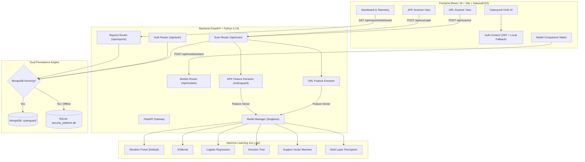

# CyberGuard — AI-Powered Cybersecurity Threat Intelligence Platform

[](https://fastapi.tiangolo.com/)
[](https://react.dev/)
[](https://vitejs.dev/)
[](https://scikit-learn.org/)
[](https://xgboost.readthedocs.io/)
[](https://tailwindcss.com/)
[](https://www.mongodb.com/)

**CyberGuard** is an end-to-end intelligent security platform that automates threat scoring and vulnerability analysis for **Suspicious URLs** and **Android Application Packages (APKs)**. Powered by a collection of trained Machine Learning classifiers and static heuristic pipelines, CyberGuard provides real-time telemetry, model benchmarks, and detailed risk breakdowns through a futuristic, cyberpunk-styled dashboard.

---

## Table of Contents
1. [Core Features](#core-features)
2. [Architecture Overview](#architecture-overview)
3. [Technology Stack](#technology-stack)
4. [Machine Learning & Threat Classification](#machine-learning--threat-classification)
5. [Feature Extraction Pipelines](#feature-extraction-pipelines)
6. [Project Structure](#project-structure)
7. [Installation & Setup](#installation--setup)
8. [API Endpoints](#api-endpoints)
9. [Resilience & Fallback Architecture](#resilience--fallback-architecture)
10. [Roadmap & Enhancements](#roadmap--enhancements)

---

## Core Features

- **Phishing & Malicious URL Scanner**:
  - Delimiter pattern analysis (`.`, `/`, `-`).
  - IP-based hostname detection.
  - SSL/TLS protocol verification.
  - High-risk credential-harvesting keyword inspection.
- **Android APK Security Inspector**:
  - Static decompilation and Android Manifest analysis.
  - Total and dangerous permissions audit (`RECEIVE_BOOT_COMPLETED`, `SEND_SMS`, `SYSTEM_ALERT_WINDOW`, etc.).
  - Component count profiling (Activities, Services, Broadcast Receivers).
  - Target SDK version risk evaluation.
- **Multi-Model Machine Learning Engine**:
  - Live swapping between 6 classifiers without restarting the server.
  - Supported algorithms: Random Forest, XGBoost, Support Vector Machine (SVM), Multi-Layer Perceptron (MLP Neural Net), Decision Tree, and Logistic Regression.
  - Real-time threat probability score (`0.0%` to `100.0%`).
- **Telemetry & Threat Analytics Dashboard**:
  - Aggregate statistics (Total Scans, Malicious vs. Safe ratios).
  - Interactive distribution charts via Recharts.
  - Searchable datalog history with one-click purge capability.
- **Enterprise-Grade Security**:
  - JWT Bearer Authentication (`HS256`) with salted bcrypt password hashing.
  - Protected API routes and client-side route guards.

---

## Architecture Overview



---

## Technology Stack

### Frontend
- **Framework**: [React 19](https://react.dev/)
- **Bundler & Dev Server**: [Vite 8](https://vitejs.dev/)
- **Routing**: [React Router 7](https://reactrouter.com/)
- **Styling**: [Tailwind CSS 3](https://tailwindcss.com/) with custom cyberpunk theme and glassmorphism styling
- **Charts & Data Viz**: [Recharts 3](https://recharts.org/)
- **Icons**: [Lucide React](https://lucide.dev/)
- **Linting**: [Oxlint](https://oxc.rs/)

### Backend & Machine Learning
- **API Framework**: [FastAPI](https://fastapi.tiangolo.com/)
- **ASGI Server**: [Uvicorn](https://www.uvicorn.org/)
- **Validation**: [Pydantic v2](https://docs.pydantic.dev/)
- **Authentication**: PyJWT & passlib (bcrypt)
- **ML Frameworks**: [scikit-learn](https://scikit-learn.org/), [XGBoost](https://xgboost.readthedocs.io/)
- **Data Analysis**: [pandas](https://pandas.pydata.org/), [NumPy](https://numpy.org/)
- **Serialization**: [Joblib](https://joblib.readthedocs.io/)
- **Binary/APK Parsing**: [Androguard](https://github.com/androguard/androguard) (with heuristic fallback)
- **Database**: [MongoDB](https://www.mongodb.com/) (`pymongo`, `motor`) with automatic [SQLite3](https://www.sqlite.org/) fallback

---

## Machine Learning & Threat Classification

CyberGuard implements dynamic model management through `ModelManager`. At startup, if serialized model binaries are missing from `backend/app/ml/saved_models/`, the platform executes an automated statistical synthesis pipeline to generate datasets and train all 6 classifiers.

### Classifier Benchmark Reference

| Model | Accuracy | F1 Score | Precision | Training Time | Description |
| :--- | :---: | :---: | :---: | :---: | :--- |
| **XGBoost** | **97.8%** | **97.4%** | **97.6%** | 3.4s | Gradient boosted decision trees; highest accuracy index. |
| **Random Forest** *(Default)* | **96.5%** | **95.8%** | **96.2%** | 1.2s | Balanced ensemble model; resilient against noise and layout shifts. |
| **Multi-Layer Perceptron (MLP)** | **95.9%** | **95.2%** | **95.6%** | 8.7s | Neural network with hidden layers `(16, 8)`; models complex non-linear combinations. |
| **Support Vector Machine (SVM)** | **94.2%** | **93.5%** | **94.0%** | 4.1s | RBF kernel boundary with calibrated probability outputs. |
| **Decision Tree** | **91.5%** | **90.8%** | **91.2%** | 0.3s | Fast, highly interpretable decision splits; capped at depth 6. |
| **Logistic Regression** | **89.4%** | **88.7%** | **89.0%** | 0.1s | Fast linear boundary baseline reference. |

---

## Feature Extraction Pipelines

### 1. URL Analysis (`url_extractor.py`)
Converts raw web URLs into a 6-dimensional numeric feature vector:
1. `is_https`: Boolean flag indicating SSL/TLS encryption (`1` or `0`).
2. `is_ip_host`: Flags direct IPv4 hostname usage instead of domain names.
3. `dot_count`: Total occurrences of `.` in the URL string.
4. `slash_count`: Total occurrences of `/` in the path hierarchy.
5. `dash_count`: Total occurrences of `-` (frequently used in spoofing subdomains).
6. `sensitive_word_count`: Frequency of credential-harvesting triggers (`login`, `secure`, `verify`, `update`, `banking`, `signin`, `account`, `paypal`, `ebay`, `amazon`, `webscr`).

### 2. Android APK Analysis (`apk_extractor.py`)
Decompiles the package and extracts structural metrics:
1. `permissions_count`: Volume of requested system permissions.
2. `has_boot_permission`: Flags `RECEIVE_BOOT_COMPLETED` for persistent background auto-start.
3. `has_sms_permission`: Flags `SEND_SMS` indicating premium-rate toll fraud risk.
4. `activities_count`: Number of declared UI screens.
5. `services_count`: Number of declared background services.
6. `receivers_count`: Declared broadcast listeners.
7. `target_sdk`: Target Android API level for security sandbox enforcement.

---

## Project Structure

```text
CyberGuard/
├── backend/
│   ├── app/
│   │   ├── ml/
│   │   │   ├── saved_models/          # Serialized .pkl ML model weights
│   │   │   ├── __init__.py
│   │   │   └── model_manager.py       # Classifier loading, training, and inference singleton
│   │   ├── routes/
│   │   │   ├── __init__.py
│   │   │   ├── auth.py                # Registration, login, profile routes
│   │   │   ├── models.py              # Model selection and status routes
│   │   │   ├── reports.py             # Dashboard metrics and scan logs
│   │   │   └── scan.py                # URL and APK scanning endpoints
│   │   ├── utils/
│   │   │   ├── __init__.py
│   │   │   ├── apk_extractor.py       # APK decompilation & feature parsing
│   │   │   ├── dataset_generator.py   # Synthetic threat dataset synthesizer
│   │   │   └── url_extractor.py       # URL lexical feature extractor
│   │   ├── __init__.py
│   │   ├── auth.py                    # JWT token creation and bcrypt utilities
│   │   ├── database.py                # Dual-database layer (MongoDB + SQLite)
│   │   └── main.py                    # FastAPI initialization and CORS setup
│   ├── requirements.txt               # Backend Python dependencies
│   └── security_platform.db           # SQLite fallback database
├── frontend/
│   ├── public/                        # Static SVG icons and favicon
│   ├── src/
│   │   ├── assets/                    # Background graphics and branding assets
│   │   ├── components/
│   │   │   ├── Footer.jsx             # Cyberpunk telemetry footer
│   │   │   ├── GlassCard.jsx          # Reusable glassmorphic UI card
│   │   │   └── Navbar.jsx             # Navigation HUD with status monitors
│   │   ├── context/
│   │   │   └── AuthContext.jsx        # JWT state and offline fallback credentials
│   │   ├── pages/
│   │   │   ├── APKScanner.jsx         # Binary file upload and analysis UI
│   │   │   ├── Dashboard.jsx          # Threat distribution and recent scans
│   │   │   ├── Login.jsx              # User login screen
│   │   │   ├── ModelComparison.jsx    # Model benchmark matrix & switcher
│   │   │   ├── Register.jsx           # User registration screen
│   │   │   └── URLScanner.jsx         # URL analysis UI with stage progress
│   │   ├── App.css
│   │   ├── App.jsx                    # Routing configuration and protected routes
│   │   ├── index.css                  # Tailwind styles and scanline animations
│   │   └── main.jsx                   # React 19 entrypoint
│   ├── package.json                   # Frontend dependencies and scripts
│   ├── tailwind.config.js             # Theme color palette (cyber-neon accents)
│   └── vite.config.js                 # Vite bundler configuration
└── README.md                          # Complete project documentation
```

---

## Installation & Setup

### Prerequisites
- **Python**: 3.10+ (Tested up to Python 3.14)
- **Node.js**: v18.0.0+ (with npm)
- *(Optional)* **MongoDB**: Running instance on `mongodb://localhost:27017/` (if unavailable, SQLite is used automatically).

---

### 1. Backend Setup

1. Open a terminal and navigate to the `backend` directory:
   ```bash
   cd backend
   ```

2. Create and activate a Python virtual environment:
   ```powershell
   # Windows (PowerShell)
   python -m venv venv
   .\venv\Scripts\Activate.ps1

   # Linux / macOS
   python3 -m venv venv
   source venv/bin/activate
   ```

3. Install required packages:
   ```bash
   pip install -r requirements.txt
   ```

4. Launch the FastAPI server:
   ```bash
   uvicorn app.main:app --reload --port 8000
   ```
   The backend will be running at `http://localhost:8000`.  
   Interactive API docs (Swagger UI) are accessible at `http://localhost:8000/docs`.

---

### 2. Frontend Setup

1. Open a second terminal and navigate to the `frontend` directory:
   ```bash
   cd frontend
   ```

2. Install dependencies:
   ```bash
   npm install
   ```

3. Start the Vite development server:
   ```bash
   npm run dev
   ```

4. Access the CyberGuard HUD at `http://localhost:5173`.

---

## API Endpoints

| Method | Route | Description | Auth Required |
| :--- | :--- | :--- | :---: |
| `GET` | `/` | API status and active classifier indicator | No |
| `POST` | `/api/auth/register` | Register a new user (`username`, `email`, `password`) | No |
| `POST` | `/api/auth/login` | OAuth2 password login returning JWT access token | No |
| `GET` | `/api/auth/me` | Fetch active user credentials | Yes |
| `POST` | `/api/scan/url` | Submit URL string for feature extraction & threat score | No |
| `POST` | `/api/scan/apk` | Multipart file upload for APK decompilation & threat score | No |
| `GET` | `/api/models/active` | Get currently active machine learning model name | No |
| `POST` | `/api/models/select` | Switch active classifier (`model_name`) | No |
| `GET` | `/api/reports/dashboard` | Get telemetry, aggregate threat ratios, and scan logs | Yes |
| `DELETE` | `/api/reports/clear` | Purge all scan history records | Yes |

---

## Resilience & Fallback Architecture

To ensure zero-downtime during offline evaluations or development workflows:
1. **Database Fallback**:
   - `backend/app/database.py` pings MongoDB on startup with a 1000ms timeout.
   - If MongoDB is unreachable, it silently transitions to an embedded SQLite database (`security_platform.db`).
2. **Client-Side Dev Mode Fallback**:
   - In `AuthContext.jsx`, `Dashboard.jsx`, and `URLScanner.jsx`, if the FastAPI backend is temporarily unreachable, the frontend falls back gracefully to local heuristic computation and `localStorage` caching so interface evaluation remains functional.

---

## Roadmap & Enhancements

- [ ] **Dynamic Sandbox Execution**: Integrate sandbox hooks (e.g., Cuckoo or Frida) to execute APKs in an isolated Android emulator.
- [ ] **WHOIS & Domain Age Enrichment**: Query domain registration age and SSL certificate issuers for URL threat vectors.
- [ ] **Docker Orchestration**: Provide a multi-container `docker-compose.yml` bundling the FastAPI backend, React frontend, and a MongoDB container.
- [ ] **Automated Report Export**: PDF and STIX/TAXII threat intelligence report export functionality.

---

## License

This project is licensed under the MIT License. See `LICENSE` for details.
